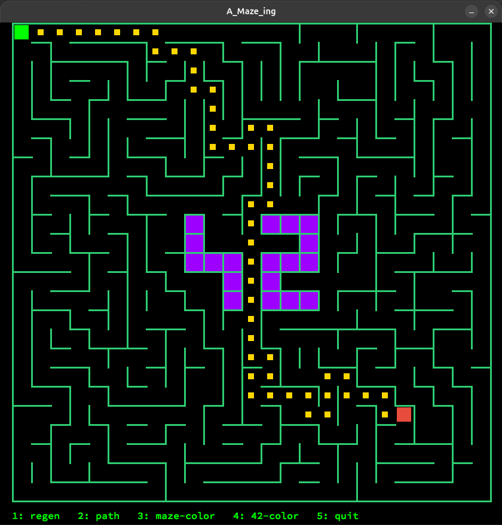

*This project has been created as part of the 42 curriculum by dneves-d, YANN*

<h1 align="center">🎮  A-Maze-ing</h1>

<p align="center">
  <b>The foundational framework of the 42 curriculum.</b><br>
  An implementation of a custom C library replicating standard system behaviors and dynamic data structures.
</p>

<p align="center">
  
  
  

</p>
<p align="center">
   
</p>

---

## 📋 Description

A-Maze-ing is a maze-generation project for the 42 curriculum. The program reads maze settings from a plain-text configuration file, generates a maze, writes its wall structure and a shortest path to an output file, and provides a visual representation of the result.

The required implementation is written in Python 3.10 or later. It must support reproducibility through a seed, validate maze structure, and provide both perfect and non-perfect maze modes.

## Features and requirements


## 🛠️ Instructions

### Requirements

- Python 3.10 or later.

### Installation and execution


1. **Clone the repository:**
```Bash
   git clone <repository-url> a_maze_ing
   cd a_maze_ing
```

2. **Set up a virtual environment and activate it:**
```Bash
   python3 -m venv venv
   source venv/bin/activate  # Linux/macOS
```

3. **Install dependencies:**
```Bash
make install
```

4. **Run the program with make**
```Bash
make run
```

Or to run it manually, activate the virtual environment first:

```Bash
source .venv/bin/activate
python3 a_maze_ing.py config.txt
```

Then type:
```Bash
   python3 a_maze_ing.py config.txt
```

### Configuration file
You can change the configuration values for the Maze generator.
The **config.txt** file uses one `KEY=VALUE` pair per line. Lines whose first character is `#` are comments and are ignored. The following keys are required:

| Key | Meaning | Example |
| --- | --- | --- |
| `WIDTH` | Maze width in cells | `WIDTH=20` |
| `HEIGHT` | Maze height in cells | `HEIGHT=15` |
| `ENTRY` | Entry cell coordinates `(x,y)` | `ENTRY=0,0` |
| `EXIT` | Exit cell coordinates `(x,y)` | `EXIT=19,14` |
| `OUTPUT_FILE` | Destination for the generated maze | `OUTPUT_FILE=maze.txt` |
| `PERFECT` | Whether to generate a perfect maze (`True` or `False`) | `PERFECT=True` |

Example configuration:

```text
# Maze dimensions, in cells
WIDTH=20
HEIGHT=15

# Coordinates use x,y; cells must be inside the maze
ENTRY=0,0
EXIT=19,14

OUTPUT_FILE=maze.txt
PERFECT=True

# Optional seed to keep the same maze format.
SEED=42
```

Entry and exit must be distinct, valid cells within the configured dimensions.

### Maze modes

- **Perfect mode (`PERFECT=True`):** the maze has exactly one path between the entry and exit; a perfect maze has no loops.
- **Default/non-perfect mode (`PERFECT=False`):** the maze remain fully connected, with open corners and centre, at least two independent routes, and only a small number of dead ends.

The entry and exit are cells inside the maze, not openings through the outside border.

### Output format

The output contains one hexadecimal digit per cell, with cells written row by row and one row per line. A wall is encoded as `1` when closed and `0` when open:

| Bit | Direction |
| --- | --- |
| 0 (least significant bit) | North |
| 1 | East |
| 2 | South |
| 3 (most significant bit) | West |

> For example, hexadecimal `3` (`0011` in binary) indicates closed north and east walls; hexadecimal `A` (`1010`) indicates closed east and west walls. After the maze rows, there is an empty line followed by three lines: entry coordinates, exit coordinates, and the shortest valid path from entry to exit, represented with `N`, `E`, `S`, and `W`. Lines end with a newline.

### Visualization and controls

This maze is generated by window using MLX. The user is able to generate another maze, show or hide a valid shortest path, and change wall colours.


## Algorithm

- **Algorithm implemented:** The maze is generated using a randomized depth-first search (DFS), also known as the recursive backtracker. Starting from the entry cell, the algorithm chooses a random unvisited neighboring cell, removes the wall between the two cells, and continues until all reachable cells have been visited. The resulting maze is perfect when `PERFECT=True`. When `PERFECT=False`, additional walls are removed to create loops and reduce dead ends.

- **Why it was chosen:** The recursive backtracker is straightforward to implement and produces connected mazes with a unique path between cells, which is appropriate for the perfect-maze mode. It also provides a reliable starting point for the non-perfect mode, where extra passages can be opened afterward.

- **Seed and reproducibility:** Maze generation uses Python’s `random` module. When a seed is provided, the same seed and configuration produce the same maze. When no seed is provided, the maze is randomized. The seed can be configured through the configuration file.

- **42 pattern and corridor-width constraints:** When the maze is large enough, cells forming the “42” pattern are kept fully closed and excluded from maze traversal. If the maze is too small to contain the pattern, the program prints an error message and omits it. The non-perfect mode opens extra passages to create loops and reduce dead ends; the generated maze should also be checked with the provided `maze_analyzer.py` to verify connectivity and ensure that no open area is 3×3 or larger.


## Reusable generator

The maze generation logic is packaged as a standalone, pip-installable
module called `mazegen`. It contains two files and does not depend on
the rest of the project (no MLX, no config parser):

- `maze_generator.py`: the `MazeGenerator` class (maze generation).
- `maze_solver.py`: the `MazeSolver` class (shortest path with BFS).

### Make a virtual enviroment and install mazegen.*whl:

```
python3 -m venv my_venv
source my_venv/bin/activate
pip install mazegen-1.0.0-py3-none-any.whl
```

Creat a file: maze.py and type the code:

``` python
from maze_generator import MazeGenerator
from maze_solver import MazeSolver

# Instantiate with custom parameters
maze = MazeGenerator(
    width=20,
    height=15,
    entry=(0, 0),
    exit_coords=(19, 14),
    perfect=True,
    seed=42,
)
maze.generate()

# Access the maze structure
print(maze.grid[0][0])
print(maze.get_cell(3, 2))

# Access the solution (shortest path from entry to exit)
solver = MazeSolver(maze.grid, maze.width, maze.height,
                    maze.entry, maze.exit_coords)
path = solver.solve()
print(path)
```
Run it with the virtual environment active:
```
python3 maze.py
```

### Parameters

- `width`, `height`: maze size in cells (both at least 1).
- `entry`, `exit_coords`: `(x, y)` coordinates, inside the maze and different from each other.
- `perfect`: `True` for a single path between any two cells, `False` to allow loops.
- `seed`: optional integer; the same seed always gives the same maze.

### Rebuilding the package (developers only)

After changing `maze_generator.py` or `maze_solver.py`, run `make build`
and commit the new `.whl`.


## Team and project management

### Team roles

| `Team member` | `Role and responsibilities` |
| --- | --- |
| dneves-d/Daniel | display, config parser, config.txt, LICENSE.md, resuable maze, utils, readme |
| login/Yann | display, a_maze_ing, display, maze solver, output, readme, make file |


### Planning and retrospective

- **Initial plan:**set up the inital structure. _First:_ step with config parser and maze generator. _Second:_ maze solver (BFS) and maze generator (DFS). _Third:_ display (ASCII). _Fourth:_ output and display (mlx). _Fifth:_ maze generator(perfect false), readme.
- **How the plan evolved:** Each member took turns working on most of the files.
- **What worked well:** The division of activities.
- **What could be improved:** Version Control reducing
conflict.
- **Tools used:** GitHub, VSCode, Internet, AI and Systems: Linux and McOs.

## Resources

- 42 subject, *A-Maze-ing*, version 2.3 — primary functional and submission requirements provided for this project.

- [Python documentation](https://docs.python.org/3/) — language and standard-library reference.

- [Python `random` module documentation](https://docs.python.org/3/library/random.html) — reference if the implementation uses Python's standard pseudo-random generator.

- [Graph theory](https://en.wikipedia.org/wiki/Graph_theory) — background for connectivity, paths, loops, and spanning trees. Use this as introductory context, not as a substitute for verifying algorithm details.

- [Mlx documentation](https://ml-explore.github.io/mlx/build/html/index.html) - guide orientation

- [Minilibx](https://harm-smits.github.io/42docs/libs/minilibx) - for screen visualisation

### 🤖 AI Usage Disclaimer:

As per the 42 ICT training framework rules, AI tools were utilized responsibly during this project:

- **Tasks Assisted:** Conceptual explanations of Makefile, path, generator, tracker, BFS and DFS Algorithms

- **Refactoring & Documentation:** Helped suggesting refactors for improving readability and generating docstrings.
All functions and classes implementations were written manually.
